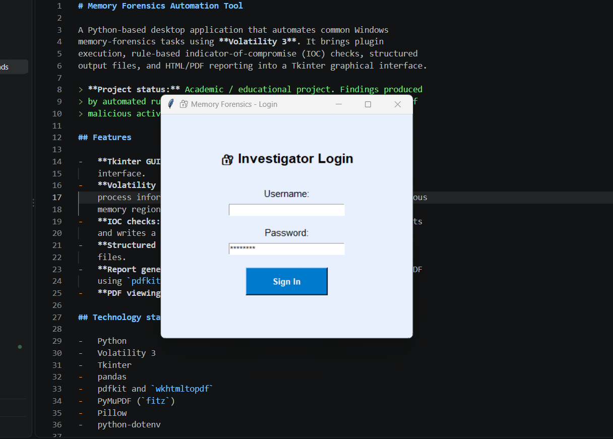
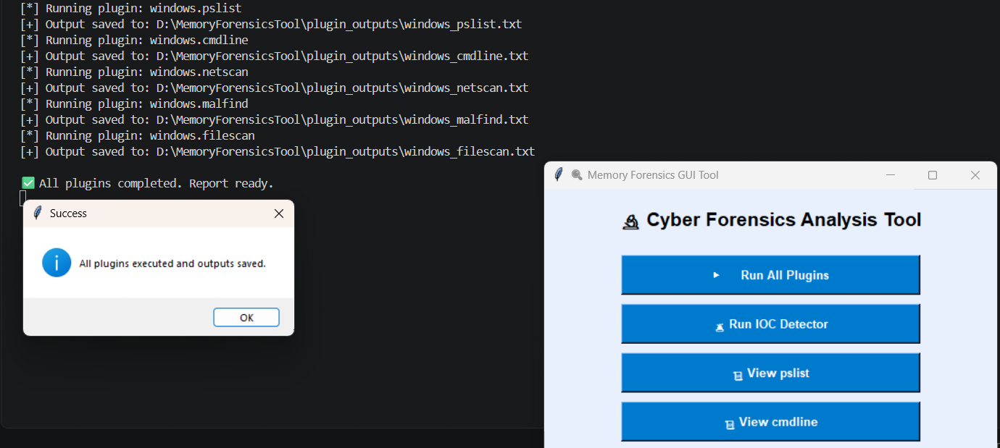
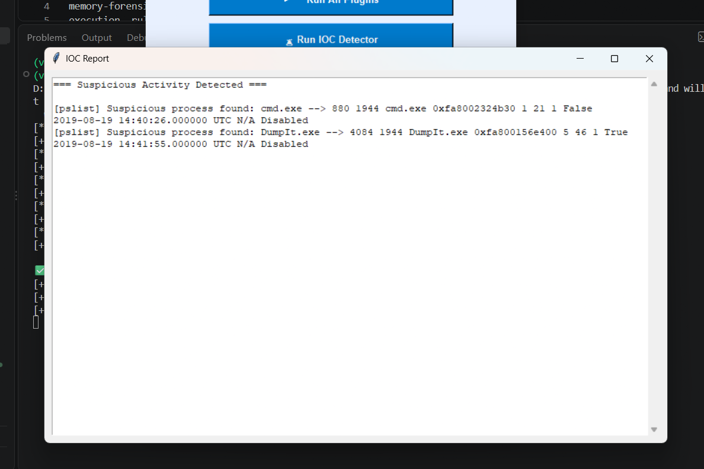
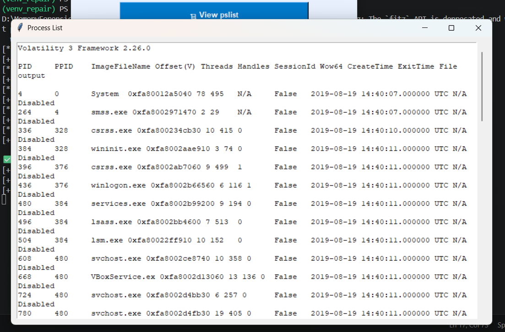
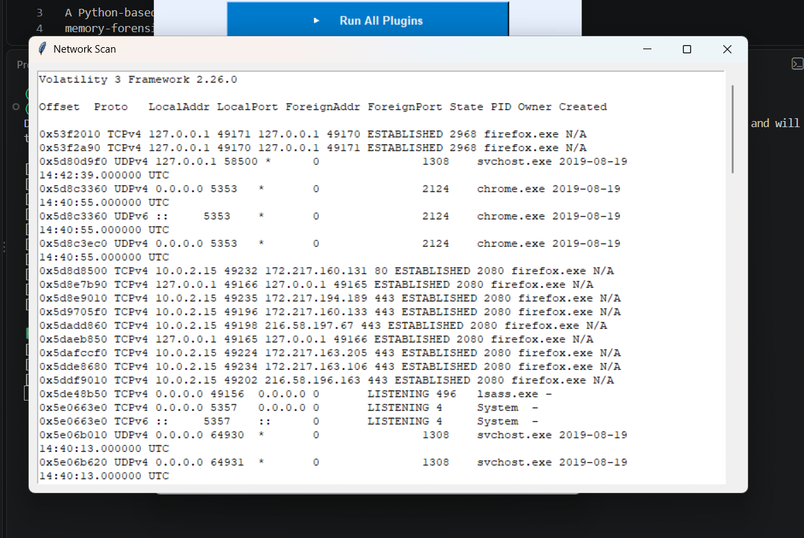
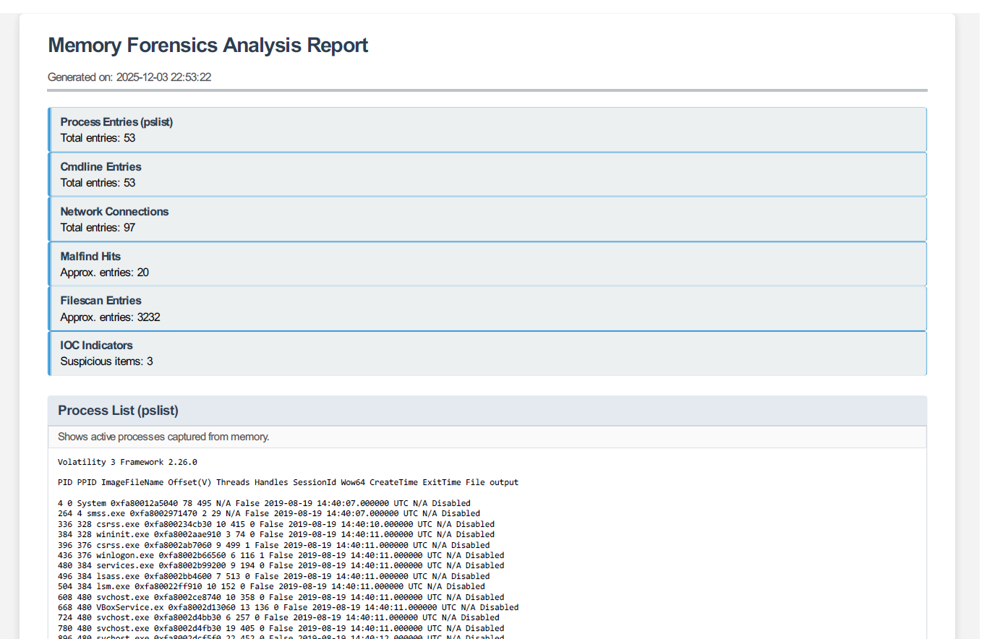
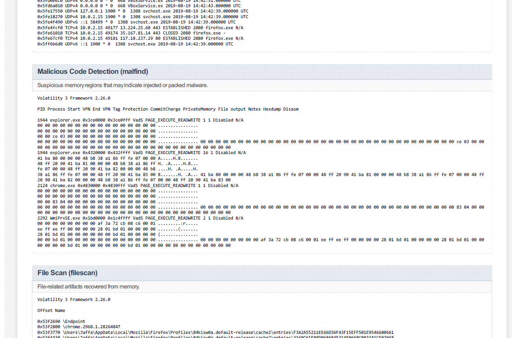
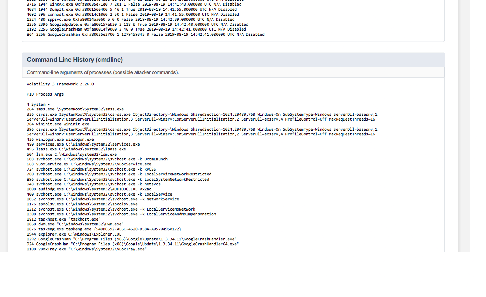
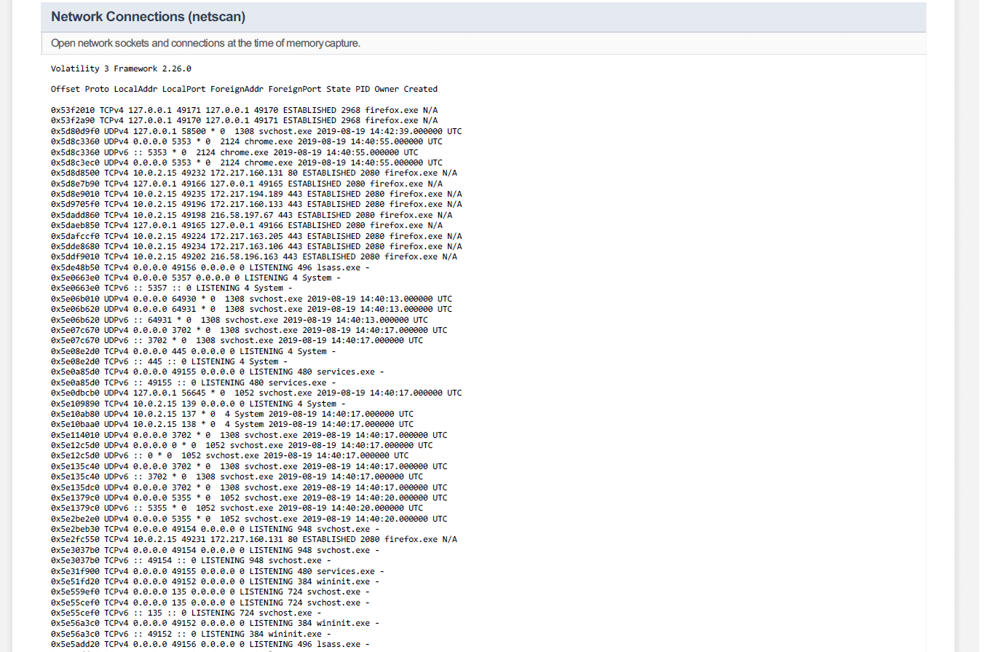
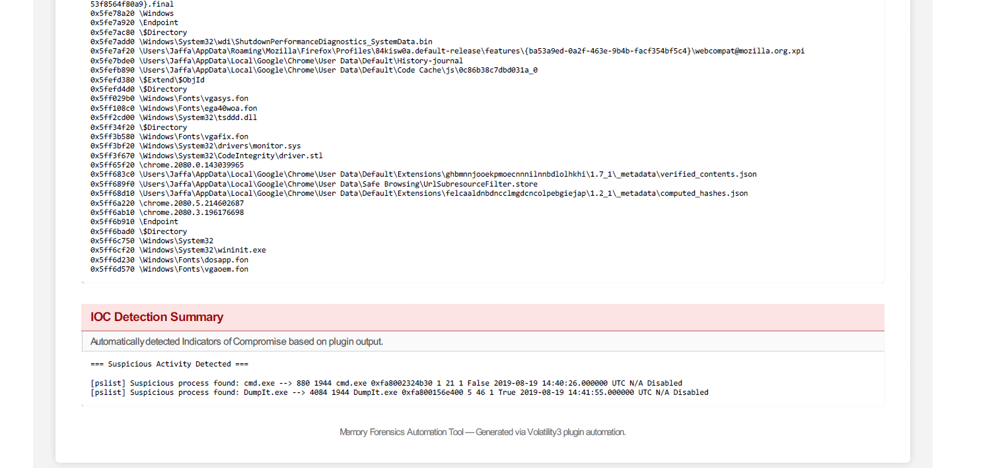

# Memory Forensics Automation Tool

A Python-based desktop application for automating Windows memory forensics using **Volatility 3**. The tool provides a graphical interface for running forensic plugins, detecting suspicious indicators, viewing analysis results, and generating structured forensic reports.

## 📸 Screenshots

### Main Application Interface


### Plugin Execution


### IOC Detection Report


### Process Analysis


### Network Analysis


### Forensic Analysis Report






## ✨ Features

- **Graphical User Interface:** Simple desktop interface built with Python Tkinter.
- **Automated Plugin Execution:** Runs selected Volatility 3 plugins to collect memory-forensics artifacts.
- **Process Analysis:** Extracts active process information using `windows.pslist`.
- **Command-Line Analysis:** Examines process command-line arguments using `windows.cmdline`.
- **Network Analysis:** Examines network connections using `windows.netscan`.
- **Malicious Memory Detection:** Uses `windows.malfind` to identify potentially suspicious memory regions.
- **File Artifact Scanning:** Uses `windows.filescan` to identify file-related artifacts in memory.
- **IOC Detection:** Performs rule-based checks on plugin output for potentially suspicious indicators.
- **Forensic Reporting:** Generates HTML/PDF reports containing analysis results and summaries.
- **CSV Export:** Supports exporting selected forensic results into CSV format.

## 🛠️ Technology Stack

- Python
- Volatility 3
- Tkinter
- Pandas
- PyMuPDF
- Pillow
- pdfkit
- wkhtmltopdf
- python-dotenv

## 📁 Project Structure

```text
MemoryForensicsTool/
├── scripts/
│   ├── forensics_gui.py
│   ├── generate_report.py
│   ├── html_to_pdf.py
│   ├── ioc_detector.py
│   ├── run_all_plugins.py
│   ├── run_pslist.py
│   ├── run_pslist_to_txt.py
│   └── test_import.py
├── screenshots/
├── dumps/                 # Local memory dumps; not committed
├── plugin_outputs/        # Generated analysis results; not committed
├── requirements.txt
├── .gitignore
├── .env                   # Local configuration; not committed
└── README.md
```

## ⚙️ Installation

### 1. Clone the repository

```bash
git clone https://github.com/Vijay-krishna-G/memory-forensics-automation-tool.git
cd memory-forensics-automation-tool
```

### 2. Create a virtual environment

```bash
python -m venv .venv
```

### 3. Activate the environment

**Windows PowerShell:**

```powershell
.\.venv\Scripts\Activate.ps1
```

### 4. Install dependencies

```bash
python -m pip install -r requirements.txt
```

### 5. Prepare the memory dump

Place a compatible Windows memory image in the local `dumps/` directory and configure the application to use its path.

**Note:** Memory dumps and generated forensic evidence are not included in this public repository. You must supply your own authorized test memory image.

### 6. Configure environment variables

Create a local `.env` file if required by the application. Configure the login settings using the variable names expected by the application. Do not commit `.env` or real credentials to GitHub.

## ▶️ Usage

From the project root, activate your virtual environment and run:

```bash
python scripts/forensics_gui.py
```

Then:

1. Sign in using your locally configured credentials.
2. Open the application's case interface.
3. Run the available Volatility 3 plugins.
4. Review process, command-line, and network results.
5. Run the IOC detector to identify potentially suspicious artifacts.
6. Generate and review the forensic report.
7. Export supported results to CSV when needed.

Some application features may depend on the expected local memory-dump path and the required external PDF-rendering utility.

## 🔍 Forensic Analysis Workflow

1. **Input:** Load an authorized Windows memory image.
2. **Analysis:** Execute Volatility 3 plugins against the image.
3. **Detection:** Apply rule-based IOC checks to selected outputs.
4. **Reporting:** Generate structured forensic reports.
5. **Export:** Save supported results for further investigation.

## 🔐 Security and Evidence Handling

- Use memory images only when you have permission to analyze them.
- Keep original evidence unchanged and work with verified copies.
- Record evidence hashes and relevant investigation details where appropriate.
- Treat IOC matches as leads requiring further investigation, not automatic proof of malicious activity.
- Do not upload private memory dumps, credentials, personal data, or confidential investigation results.

## ⚠️ Limitations

- This is an academic and educational project, not a replacement for a complete digital-forensics platform.
- IOC detection uses rules and may produce false positives or miss suspicious activity.
- Findings depend on the quality and compatibility of the memory image and the available Volatility 3 plugins.
- The application currently relies on local configuration and a predefined workflow; additional case-management and evidence-integrity features may be developed in future versions.

## 🚀 Future Improvements

- Enhanced case management and evidence tracking.
- Improved IOC rules and configurable detection patterns.
- Additional forensic analysis modules.
- More comprehensive report summaries and visualizations.
- Stronger evidence-integrity verification and audit logging.
- Improved interface and usability.

## 🎓 Project Information

**Project:** Memory Forensics Automation Tool  
**Domain:** Cyber Forensics / Digital Forensics and Incident Response (DFIR)  
**Framework:** Volatility 3  
**Interface:** Python Tkinter

This project was developed for academic learning and practical exploration of memory-forensics automation.

## ⚖️ Disclaimer

This tool is intended for authorized digital-forensics analysis, cybersecurity education, and research. The developer is not responsible for unauthorized use or misuse of the software.
